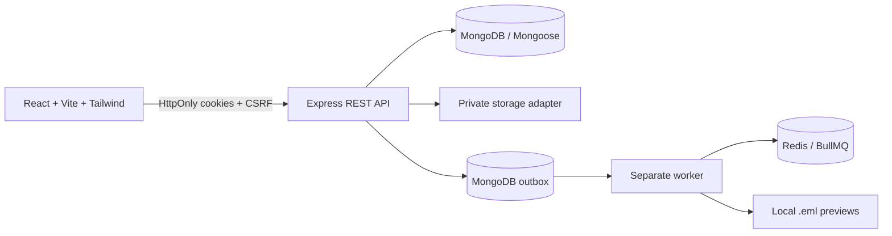
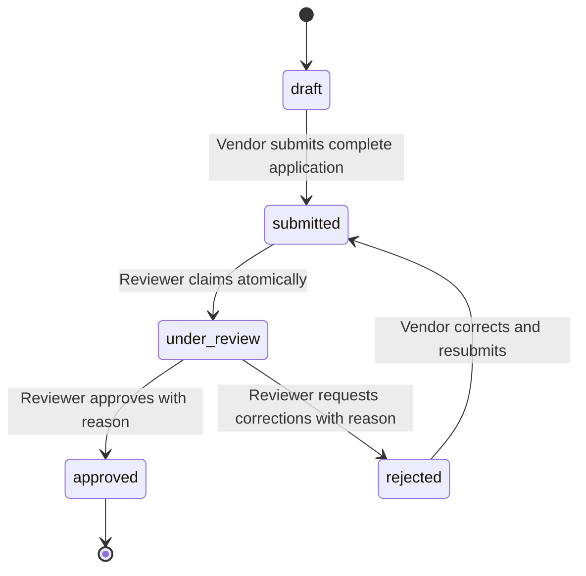

# Edvexa Vendor Onboarding Platform

Edvexa is a secure vendor onboarding and document verification platform. Vendors submit business information and private compliance documents, reviewers verify submitted applications, and administrators manage users, monitor operations, and recover failed background work.

The application is implemented in JavaScript and is split into an independently runnable React frontend and Express backend.

## Contents

- [Features](#features)
- [Architecture](#architecture)
- [Technology](#technology)
- [Roles and permissions](#roles-and-permissions)
- [Application workflow](#application-workflow)
- [Project structure](#project-structure)
- [Prerequisites](#prerequisites)
- [Local setup](#local-setup)
- [Running the application](#running-the-application)
- [Demo users](#demo-users)
- [Configuration](#configuration)
- [API overview](#api-overview)
- [Storage](#storage)
- [Background processing](#background-processing)
- [Security](#security)
- [Testing and validation](#testing-and-validation)
- [Troubleshooting](#troubleshooting)
- [Known limitations](#known-limitations)

## Features

### Vendor experience

- Public vendor registration and cookie-based login.
- Business profile management, including contact and address details.
- Draft creation and editing.
- Private registration-certificate and identity-document uploads.
- Document replacement and deletion before submission.
- Submission and resubmission after corrections.
- Application status, reviewer feedback, and audit history.

### Reviewer experience

- Queue of available and assigned applications.
- Atomic application claiming to prevent conflicting reviews.
- Authorized private document access.
- Approval and correction-request decisions with mandatory reasons.
- Application audit history.

### Administrator experience

- Application totals and status metrics.
- Searchable, filterable, paginated application oversight.
- Reviewer and administrator provisioning.
- Queue health, event, and notification monitoring.
- Failed outbox-event recovery.

### Platform capabilities

- JWT access and refresh sessions stored in signed, HttpOnly cookies.
- Vendor-only public registration; privileged users are provisioned by an administrator or seed script.
- Role-based authorization and resource-ownership checks on the backend.
- Zod request validation, secure headers, CORS, CSRF protection, rate limiting, and structured redacted logging.
- Durable MongoDB outbox events and a separate BullMQ worker.
- Idempotent notifications with bounded retries and local `.eml` previews.
- OpenAPI documentation served by the API.

## Architecture



The browser never receives raw JWT values or permanent public document URLs. The API authorizes every profile, audit, and document request. Application status changes, audit records, and outbox events are grouped in a MongoDB transaction when transactions are available. Standalone development MongoDB uses conditional updates and compensating rollback logic.

## Technology

| Layer | Technology |
| --- | --- |
| Frontend | React 19, Vite, Tailwind CSS, JavaScript |
| Backend | Node.js, Express, JavaScript |
| Persistence | MongoDB, Mongoose |
| Authentication | JWT, signed cookies, bcryptjs |
| Validation | Zod |
| Security | Helmet, CORS, CSRF double-submit cookie, express-rate-limit |
| Queue | BullMQ and Redis, with a documented MongoDB polling fallback |
| File storage | Private local adapter or authenticated Cloudinary delivery |
| Testing | Node test runner, Jest, Supertest, MongoDB Memory Server |

## Roles and permissions

| Capability | Vendor | Reviewer | Admin |
| --- | :---: | :---: | :---: |
| Register and manage own session | Yes | Provisioned | Provisioned |
| Edit own draft or rejected application | Yes | No | No |
| Upload and replace own documents | Yes | No | No |
| Submit or resubmit own application | Yes | No | No |
| Claim and decide applications | No | Assigned queue | No |
| View authorized private documents | Own | Assigned | All |
| View audit history | Own | Assigned | All |
| View application metrics and queues | No | Review queue | All |
| Provision reviewer/admin accounts | No | No | Yes |
| Recover failed background events | No | No | Yes |

Public registration always creates a `vendor` account. A client cannot assign itself the `reviewer` or `admin` role.

## Application workflow



Rules are enforced by the backend:

- A draft cannot be submitted until required profile fields and both required documents exist.
- A reviewer must claim a submitted application before deciding it.
- Only the assigned reviewer can approve or reject an application.
- Approval and rejection require a decision reason.
- Approved applications are terminal.
- Every transition creates an append-only audit entry with actor, role, previous status, new status, reason, and timestamp.
- Conditional status and reviewer predicates prevent conflicting concurrent decisions.

## Project structure

```text
.
├── backend/
│   ├── src/
│   │   ├── auth/             Authentication and token services
│   │   ├── config/           Environment and database configuration
│   │   ├── middleware/       Auth, CSRF, errors, and request controls
│   │   ├── models/           Mongoose schemas and indexes
│   │   ├── notifications/    Notification delivery and idempotency
│   │   ├── queues/           BullMQ and event processing
│   │   ├── routes/           REST API route modules
│   │   ├── scripts/          Seed data
│   │   ├── services/         Profiles, lifecycle, and outbox operations
│   │   ├── storage/          File validation and storage adapters
│   │   ├── app.js            Express application
│   │   ├── server.js         HTTP server entry point
│   │   └── worker.js         Separate background worker entry point
│   ├── tests/                Node and Jest/Supertest tests
│   └── openapi.json          OpenAPI 3 contract
├── frontend/
│   └── src/
│       ├── App.jsx           Role-aware application UI
│       └── styles.css        Tailwind component styles
├── .env.example              Environment template
└── package.json              Root development commands
```

## Prerequisites

- Node.js 20 or newer
- npm 10 or newer
- MongoDB 7 or a MongoDB-compatible connection string
- Redis 6 or newer for the BullMQ queue

Redis is recommended for normal development. The local MongoDB polling adapter can be used when Redis is unavailable; see [Background processing](#background-processing).

## Local setup

Install dependencies from the project root:

```bash
npm install
npm --prefix frontend install
npm --prefix backend install
```

Create environment files:

```bash
cp .env.example backend/.env
cp .env.example frontend/.env
```

For `frontend/.env`, keep only:

```dotenv
VITE_API_URL=http://localhost:4000/api/v1
```

Configure `backend/.env` using the reference table below. Do not commit either `.env` file.

Start MongoDB and Redis using your local installation, then seed demonstration data:

```bash
npm run seed
```

## Running the application

Run frontend and backend together:

```bash
npm run dev
```

Or run each process separately:

```bash
npm --prefix backend run dev
npm --prefix frontend run dev
```

Run the worker in a third terminal when asynchronous processing is enabled:

```bash
npm --prefix backend run worker
```

Local URLs:

| Service | URL |
| --- | --- |
| Frontend | http://localhost:5173 |
| API | http://localhost:4000 |
| Health check | http://localhost:4000/api/v1/health |
| OpenAPI JSON | http://localhost:4000/api/v1/docs/openapi.json |

The health check returns `200` when MongoDB is connected and `503` when the API is running without a healthy database connection.

## Demo users

Run `npm run seed` to create or update the following local accounts. The seed operation is idempotent.

| Account | Email | Role |
| --- | --- | --- |
| Draft vendor | `vendor.draft@example.com` | Vendor |
| Submitted vendor | `vendor.submitted@example.com` | Vendor |
| Review vendor | `vendor.review@example.com` | Vendor |
| Approved vendor | `vendor.approved@example.com` | Vendor |
| Rejected vendor | `vendor.rejected@example.com` | Vendor |
| Reviewer | `reviewer@example.com` | Reviewer |
| Administrator | `admin@example.com` | Admin |

All seeded accounts use:

```text
DemoPassword-123!
```

These credentials are for local demonstration only. Change them before using any shared environment.

## Configuration

The complete template is in [.env.example](./.env.example).

| Variable | Default | Description |
| --- | --- | --- |
| `NODE_ENV` | `development` | Runtime environment |
| `PORT` | `4000` | Backend HTTP port |
| `CLIENT_URL` | `http://localhost:5173` | Allowed frontend origin |
| `MONGODB_URI` | Local MongoDB database | MongoDB connection string |
| `COOKIE_SECRET` | Development fallback | Cookie-signing secret |
| `JWT_ACCESS_SECRET` | Development fallback | Access-token signing secret |
| `JWT_REFRESH_SECRET` | Development fallback | Refresh-token signing secret |
| `ACCESS_TOKEN_TTL` | `15m` | Access-token lifetime |
| `REFRESH_TOKEN_TTL` | `7d` | Refresh-token lifetime |
| `QUEUE_ADAPTER` | `redis` | `redis` or `local` |
| `REDIS_URL` | `redis://127.0.0.1:6379` | Redis connection string |
| `QUEUE_MAX_ATTEMPTS` | `3` | Maximum event attempts |
| `QUEUE_BACKOFF_MS` | `1000` | Initial retry backoff |
| `WORKER_POLL_MS` | `5000` | Local adapter polling interval |
| `EMAIL_PREVIEW_PATH` | `./backend/.data/email-previews` | Local `.eml` output directory |
| `STORAGE_PROVIDER` | `local` | `local` or `cloudinary` |
| `LOCAL_STORAGE_PATH` | `./storage/private` | Private local file directory |
| `CLOUDINARY_CLOUD_NAME` | — | Cloudinary cloud name |
| `CLOUDINARY_API_KEY` | — | Cloudinary API key |
| `CLOUDINARY_API_SECRET` | — | Cloudinary API secret |

In production, provide strong, unique cookie and JWT secrets explicitly. Never use development fallbacks or commit secrets.

## API overview

The full contract, schemas, error responses, cookie requirements, and role permissions are available in [backend/openapi.json](./backend/openapi.json) and at `/api/v1/docs/openapi.json` while the server is running.

### Authentication

```text
POST  /api/v1/auth/register
POST  /api/v1/auth/login
POST  /api/v1/auth/refresh
POST  /api/v1/auth/logout
GET   /api/v1/auth/me
PATCH /api/v1/auth/me
```

### Vendor onboarding

```text
GET    /api/v1/vendor/profile
PATCH  /api/v1/vendor/profile
POST   /api/v1/vendor/submit
GET    /api/v1/vendor/applications/:profileId
GET    /api/v1/vendor/applications/:profileId/audit
GET    /api/v1/vendor/documents
POST   /api/v1/vendor/documents
GET    /api/v1/vendor/documents/:documentId
DELETE /api/v1/vendor/documents/:documentId
```

Required document types are `registration_certificate` and `identity_document`. Accepted files are PDF, JPEG, and PNG, up to 10 MB each. File signatures are checked in addition to extension and declared MIME type.

### Reviewer and administrator operations

```text
GET  /api/v1/reviews
GET  /api/v1/reviews/:profileId
POST /api/v1/reviews/:profileId/claim
POST /api/v1/reviews/:profileId/approve
POST /api/v1/reviews/:profileId/reject
GET  /api/v1/reviews/:profileId/audit

GET  /api/v1/admin/dashboard/summary
GET  /api/v1/admin/applications
GET  /api/v1/admin/applications/:profileId
GET  /api/v1/admin/applications/:profileId/audit
GET  /api/v1/admin/applications/:profileId/documents/:documentId
GET  /api/v1/admin/users
POST /api/v1/admin/users
GET  /api/v1/admin/queue/health
GET  /api/v1/admin/queue/events
GET  /api/v1/admin/queue/notifications
POST /api/v1/admin/queue/recover-failed
```

Application list endpoints support bounded `search`, `status`, `from`, `to`, `page`, and `limit` filters. Pagination is capped at 50 records per page.

## Data model

| Collection | Purpose |
| --- | --- |
| `users` | Vendor, reviewer, and administrator identities |
| `vendorprofiles` | Business details, ownership, reviewer assignment, and lifecycle state |
| `vendordocuments` | Private document metadata, versions, and processing state |
| `auditlogs` | Append-only status transition history |
| `outboxevents` | Durable asynchronous event publication and retry state |
| `notifications` | Idempotent notification delivery state |
| `refreshtokens` | Hashed rotating refresh sessions and revocation state |

Indexes cover unique email, ownership, lifecycle status, reviewer assignment, submission date, audit history, outbox retry state, and notification event IDs.

## Storage

### Local adapter

```dotenv
STORAGE_PROVIDER=local
LOCAL_STORAGE_PATH=./storage/private
```

Local files are private, are not served as static assets, and are returned only after authorization. The directory is intended for development or a single-host deployment and is ignored by source control.

### Cloudinary adapter

```dotenv
STORAGE_PROVIDER=cloudinary
CLOUDINARY_CLOUD_NAME=your-cloud-name
CLOUDINARY_API_KEY=your-api-key
CLOUDINARY_API_SECRET=your-api-secret
```

Cloudinary files use authenticated delivery and short-lived signed URLs. Do not configure sensitive identity documents for public delivery.

## Background processing

Application submission, approval, rejection, and document uploads create durable outbox work. The separate worker processes that work outside the HTTP request path.

With Redis:

```bash
redis-server
npm --prefix backend run worker
```

The BullMQ worker uses bounded retries and exponential backoff. Notifications are written as local `.eml` files; no paid email provider is required. Stable event IDs and unique notification records prevent duplicate logical notifications when events are retried or republished.

Without Redis:

```dotenv
QUEUE_ADAPTER=local
```

The local adapter polls MongoDB for pending outbox events. It is a development fallback for one worker and one host. It does not provide Redis coordination, distributed locking, or high-throughput scheduling and should not be treated as equivalent to BullMQ in a multi-instance deployment.

Failed events remain visible to administrators and can be returned to the pending state in bounded batches using `POST /api/v1/admin/queue/recover-failed`.

## Security

- Access and refresh JWTs are stored in signed, HttpOnly cookies.
- Refresh tokens are hashed in MongoDB and rotated by token family.
- State-changing requests require a CSRF header matching the readable CSRF cookie.
- CORS is restricted to `CLIENT_URL` and credentials are enabled only for that origin.
- Registration, login, and refresh are rate-limited; ordinary session checks are not counted against the authentication-attempt limit.
- Helmet adds security headers.
- Request bodies and uploads have bounded sizes.
- Zod validates request bodies and list filters.
- Search values are escaped before use in MongoDB regular expressions.
- Passwords, cookies, JWTs, private URLs, and internal stack traces are not returned to clients or written to structured logs.
- Every protected resource checks authentication, role, ownership, or reviewer assignment.
- Audit records are append-only and cannot be updated or deleted through the application.

## Testing and validation

Run all backend tests:

```bash
npm test
```

Run suites separately:

```bash
npm --prefix backend run test
npm --prefix backend run test:jest
```

The Jest/Supertest suite uses an isolated MongoDB Memory Server by default, clears collections between tests, and mocks storage and email-preview dependencies. Set `TEST_MONGODB_URI` only when CI requires an isolated external test database. Never point tests at a shared production database.

Run linting and production builds:

```bash
npm run lint
npm run build
```

The automated coverage includes authentication, RBAC, ownership, document validation, lifecycle transitions, rejection and resubmission, audit history, concurrent review protection, notification retries, worker failure handling, and duplicate-event prevention.

## Troubleshooting

### Health check returns `503`

Start MongoDB and verify `MONGODB_URI`. Then restart the backend.

### A state-changing request returns `403`

The client must first receive the CSRF cookie from `GET /api/v1`. The frontend handles this automatically. For manual requests, send the cookie value in `X-CSRF-Token`.

### A provisioning request returns `409`

The email already belongs to a user. Use a different email address; users have unique email identities.

### The worker cannot connect to Redis

Start Redis and verify `REDIS_URL`, or use the documented `QUEUE_ADAPTER=local` fallback for single-worker development.

### A document upload is rejected

Use a PDF, JPEG, or PNG under 10 MB. The extension, declared MIME type, and file signature must agree, and only one document per supported requirement can be active.

### Seed data conflicts with an existing environment

The seed command is an upsert and is intended for a local demonstration database. Use a separate `MONGODB_URI` for a clean demonstration.

### Jest cannot download MongoDB binaries

Use a CI binary cache or configure an isolated `TEST_MONGODB_URI`. Do not use a shared development or production database for tests.

## Known limitations

- Local storage is not shared across multiple application instances.
- The local queue adapter is intended for one worker only.
- Email delivery is simulated with `.eml` preview files.
- Audit history responses are bounded to the most recent 200 entries per application.
- There is no browser end-to-end test suite; frontend validation currently uses lint, production build, and local smoke testing.

## Submission checklist

```bash
npm install
npm --prefix frontend install
npm --prefix backend install
cp .env.example backend/.env
cp .env.example frontend/.env
npm run lint
npm run build
npm test
```

Before sharing the project, verify the health endpoint, OpenAPI endpoint, seeded login, one vendor submission, one reviewer decision, and worker processing. Do not commit `.env` files, private uploads, email previews, database logs, or production credentials.
